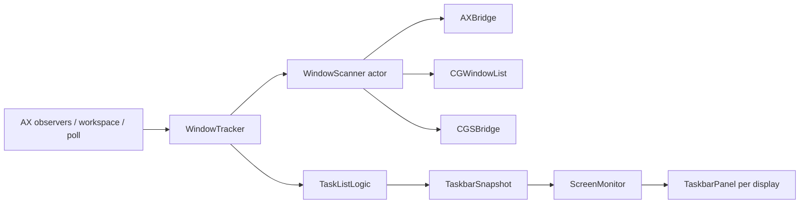
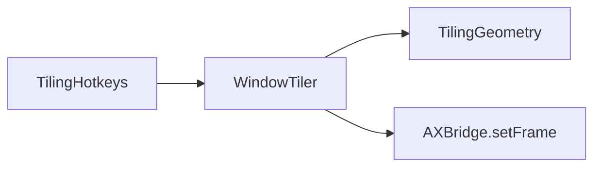

# Architecture

Omnibar is a single macOS app target (`io.specktronica.omnibar`) plus a host-app unit-test bundle. UI is AppKit except Settings and onboarding, which are SwiftUI hosted in `NSWindow`s. The process is an accessory app (`LSUIElement` / `NSApplication.ActivationPolicy.accessory`) so it does not appear in the Dock while running.

## Layout

```
Omnibar/
  App/          entry, AppDelegate, menu extra, login item
  Bridge/       Accessibility, SkyLight/CGS, Dock badge AX
  Core/         scan, track, screens, Dock, catalog, thumbnails, actions, tiling
  Model/        settings, pins, blacklist, order, snapshots, geometry
  UI/           taskbar, Start Menu, settings, onboarding
  Resources/    assets, entitlements
OmnibarTests/   logic and geometry tests (no live window-server tests)
project.yml     XcodeGen spec
scripts/        bootstrap (XcodeGen), build, clean, package/notarize, Homebrew publish, uninstall, secret scan
```

## Startup

`OmnibarMain` installs `AppDelegate` and runs `NSApplication`. On launch:

1. Load `SettingsStore` from `UserDefaults` and sync the login item.
2. Create the menu extra (`StatusItemController`).
3. Start `AppCatalog` (application directories + recents).
4. Move the Dock to the right edge and hide it when that setting is on (`DockManager`).
5. If Accessibility is trusted, start `WindowTracker`, `ScreenMonitor`, `TilingHotkeys`, `StartMenuHotkey`, and `CloseButtonMonitor`. Otherwise show onboarding. The taskbar does not start while onboarding is showing; Continue (or closing the window) posts `.omnibarPermissionsDidChange` after `isShowing` is cleared. Screen Recording is effective for capture only when `CGPreflightScreenCaptureAccess()` was already true at process start. A mid-session grant is pending restart: preflight stays false until relaunch, so onboarding detects the TCC toggle via other processes’ normal-level window titles (`kCGWindowName`). Windows not at the normal window level (menu bar, wallpaper, Dock, Control Center) are ignored because those titles appear without Screen Recording.

On quit, Dock prefs are restored, then hotkeys, the close-button monitor, tracker, screen monitor, and catalog stop.

## Window list pipeline



`WindowTracker` coalesces scans. Triggers include:

- AX notifications on regular apps (window create/destroy, title, miniaturize, focus, move, resize, hide/show)
- `NSWorkspace` launch/terminate/activate/hide/unhide and Space change
- screen parameter changes, settings/pins/blacklist/badge notifications
- a repeating poll (`pollInterval`, minimum 0.5 s)

`WindowScanner` (an actor) builds `WindowInfo` from Accessibility windows crossed with `CGWindowListCopyWindowInfo`. It keeps layer-0 windows of regular apps, skips a hard-coded system set and the blacklist, drops untitled floating and unknown windows (`AXFloatingWindow` / `AXSystemFloatingWindow` / `AXUnknown` with an empty title, such as Chrome's full-screen toolbar strips and transition snapshot), and drops frames smaller than 40×40 points. Accessibility can omit windows on inactive Spaces, so the scanner also keeps layer-0 windows from the window list whose SkyLight Spaces are not visible. These fallback entries require a confirmed ordered-in state from SkyLight; closed windows retained by a running app are excluded even when their title, bounds, and Space assignment remain. They must also be top-level windows that SkyLight tags as app windows (`SLSWindowQueryWindows` parent id 0, and tag bit `0x1`, or `0x2` with `0x8000_0000`), which drops child and helper windows such as the strips of a full-screen Chrome window on a hidden Space. When SkyLight does not answer that query, the window is kept.

Space membership and “this display is a fullscreen Space” come from private SkyLight symbols loaded in `CGSBridge` (`CGSCopyManagedDisplaySpaces` / `SLS…` and related). `TaskListLogic` then:

- filters to the current Space. “Show windows from all screens” adds windows visible on other displays. “Show windows from all Spaces” adds this display’s other desktops; with both on, every window is listed. Minimized windows remain on their last screen
- optionally collapses same-title tabs
- groups by application or emits one tile per window
- inserts pinned launchers for bundle IDs with no open windows
- applies `OrderStore` for in-session order

`ScreenMonitor` owns one `TaskbarPanel` per display, hides panels for displays in `hiddenDisplayIDs` or in a fullscreen Space, and drives auto-hide from mouse location.

## Actions and overlays

`WindowActions` raises, minimizes, unminimizes, closes, fullscreens, hides, quits, and “New Window” through `AXBridge` and `NSRunningApplication`. Primary click and middle-click are handled there. The thin Show desktop slice on the right of each bar calls `ShowDesktopController`, which minimizes every visible window on the current Spaces and restores that set on the next click.

When raising a window on an inactive Space, `WindowFocusController` requests the Space switch first and waits for a scan confirming the destination is visible before activating or restoring the window. Pending requests expire after five seconds and are replaced by later clicks. Pinned launchers search the complete window snapshot before reopening an app, including windows filtered out of the clicked taskbar.

With `quitAppOnLastWindowClose` on, `CloseButtonMonitor` also handles the red close button inside other apps. A global `NSEvent` left-mouse-down monitor hit-tests the click with `AXUIElementCopyElementAtPosition` on a background queue. It only does this for clicks inside an on-screen window Omnibar lists. A hit counts when the element's subrole is `AXCloseButton` and its window is in the snapshot, Finder and Omnibar excluded. The click is never blocked. After each scan, `CloseButtonQuitTracker` checks the watched windows. Once one is gone and the snapshot lists no window for its app, the monitor confirms before quitting: SkyLight must report the window ordered out, and the app must answer `kAXWindows` with none of the windows Omnibar listed for it. A scan can drop the windows of an app slow to answer Accessibility, so the snapshot alone is not trusted. A watched window that is still open after 60 seconds stops being watched, which leaves time to answer a save dialog. Once the window is gone, the app's other windows have 3 seconds to close too, so tabs closing a scan later still count.

Each `TaskbarPanel` owns a `StartMenuPanel` and `ThumbnailPopover`. Thumbnails use ScreenCaptureKit (`ThumbnailService`) only when Screen Recording was already granted at process start (`PermissionsManager.screenRecordingTrusted`).

`OverlapResizer` optionally shrinks the height of windows whose frames intersect the bar, on displays where `ScreenMonitor.showsTaskbar(on:)` is true. It skips fullscreen/minimized/hidden windows, windows whose `kAXSizeAttribute` is not settable, a bundle skip list, and PIDs that failed verification twice in a row. Verification re-reads the Accessibility frame 0.15 s later; that frame has a top-left origin and goes through `ScreenGeometry.cocoaRect` before the bar test.

Zooming changes a window's frame, so macOS no longer treats the shortened window as zoomed, and a second zoom grows it over the bar again. To keep zoom working as a toggle, `OverlapResizer` keeps a `FitMemory` per window ID: the last frame seen clear of the bar, the frame confirmed by verification after a fit, and the frame from before the window covered the bar. `OverlapGeometry.fitAction` turns each pass into `.none`, `.fit`, or `.restore`. A window still at its fitted frame (within `TilingGeometry.frameTolerance`) that grows downward again, with its top edge not lowered, gets the earlier frame back through `AXBridge.setFrame`. Seeing the window clear of the bar at any other frame clears the fitted and earlier frames. Memory is pruned to the scanned window IDs each pass and cleared with `reset()`, which `WindowTracker` calls while auto-resize is off.

`DockBadgeReader` reads badge strings from Dock via Accessibility on a 2 s timer.

## Window tiling



`TilingGeometry` (Model) is pure and `nonisolated`: `Tile` frames inside a usable rect, the left/right/up/down cycle (`nextTile`, including sliding a quarter to the adjacent quarter in the same row or column), the usable area (`visibleFrame` with its bottom raised above the Taskbar when `ScreenMonitor.showsTaskbar(on:)`), and the Cocoa→CG inverse of `ScreenGeometry.cocoaRect`.

`WindowTiler` resolves the frontmost app's focused window, requires `AXWindow` / `AXStandardWindow`, not fullscreen or minimized, and settable position and size (`AXUIElementIsAttributeSettable`). It converts between Cocoa and CG coordinates, calls `AXBridge.setFrame` (position, size, re-read, re-apply position if the app shifted the origin while clamping), and keeps `[CGWindowID: AppliedTile]` so a clamped window can still advance through the cycle. The memory is pruned to the current snapshot's window IDs on `.omnibarSnapshotDidChange`.

`TilingHotkeys` registers Left/Right/Up/Down Arrow with the configured modifiers through Carbon `RegisterEventHotKey` on the application event target. The C handler is `nonisolated` and hops to the main actor. No `CGEventTap` is used, so no Input Monitoring grant is needed. `eventHotKeyExistsErr` (another app owns the combination) is logged and left unregistered. Registration follows `tilingShortcutsEnabled` and `tilingModifiers` through `.omnibarSettingsDidChange`.

`StartMenuHotkey` watches Control+Option with `NSEvent` monitors, which need the Accessibility grant the taskbar already has. Pressing the chord while the menu is open closes it and returns the keyboard to the previous app. Releasing the chord alone opens the menu. Another key, click, scroll, or a tiling hotkey during the chord cancels the open. The decision lives in `StartMenuShortcut` so it can be tested without event monitors.

## Persistence

All of these are keys in `UserDefaults.standard`:

| Key | Contents |
| --- | --- |
| `omnibar.settings.v1` | JSON `AppSettings` |
| `omnibar.pins.v1` | pinned bundle IDs, order preserved |
| `omnibar.blacklist.v1` | blacklisted bundle IDs |
| `omnibar.recents.v1` | recent-launch bundle IDs |
| `omnibar.dock.backup.v1` | Dock autohide, delay, time-modifier, and orientation backup while the Dock is pinned to the right |

`OrderStore` is memory-only. `SettingsStore.resetToDefaults()` keeps the current launch-at-login value, writes default settings, reverts Dock, and clears order.

## Private and privileged APIs

| Area | Mechanism |
| --- | --- |
| Window titles, raise/minimize/close/fullscreen, move/resize for tiling | Accessibility (`AXUIElement`) |
| Window frames, on-screen set, layers | `CGWindowListCopyWindowInfo` |
| Tiling hotkeys | Carbon `RegisterEventHotKey` |
| Start Menu shortcut | `NSEvent` modifier and key monitors |
| Quit on the red close button | `NSEvent` left-mouse-down monitor + Accessibility hit-test |
| Spaces and fullscreen Spaces | SkyLight (`dlopen` of `CGS*` / `SLS*` symbols) |
| Live thumbnails | ScreenCaptureKit |
| Launch at login | `SMAppService.mainApp` |

The app is not sandboxed (`ENABLE_APP_SANDBOX` is NO; entitlements file is empty). Hardened Runtime is on.

## Tests

`OmnibarTests` covers stores, list logic, geometry, tiling geometry, paging, settings decode, onboarding/TCC helpers, thumbnails, show-desktop, overlap, and related pure helpers. Tests load the app as `TEST_HOST`. `AppDelegate` returns immediately when `XCTestCase` is present so the live tracker does not start inside the test host.
